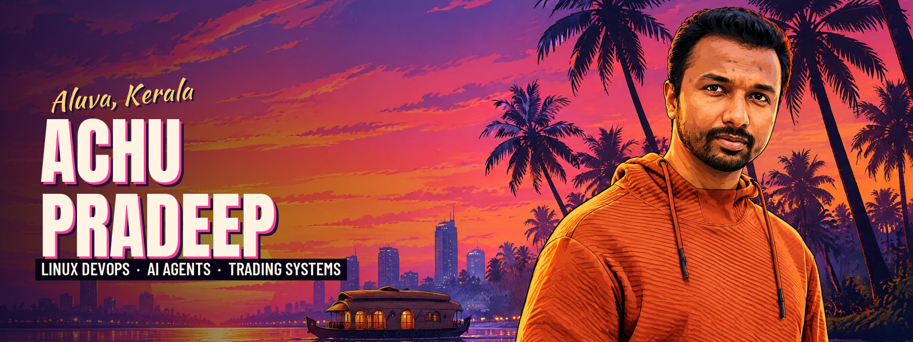
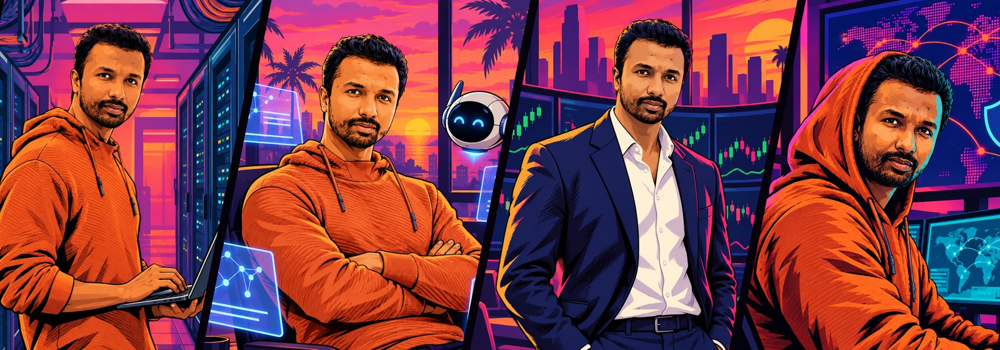

  
  
  

I'm a Linux DevOps engineer in Aluva, Kerala. I hold two Red Hat certifications and have spent four-plus years
running production systems in Kerala and Dubai. That is still my day job: CI/CD, monitoring, hardening and SIEM
for enterprise clients.

Around it I build my own products end to end: multi-agent AI systems, trading engines and bots, and security
tooling. I write the engine, the service, the front end and the deploy, and then I keep it running. Every trading
system I ship carries its own measurement, including the ideas that measurement rejected.

Counts from my résumé and my own repositories. Nothing here is a self-rating.

| Career | | Builds | |
|---|---:|---|---:|
| Years running production systems | **4+** | Projects listed below | **18** |
| Red Hat certifications | **RHCE, RHCSA** | Agents in the open-source research desk | **5** |
| Countries worked in | **India, UAE** | Native MQL5 expert advisors in mt5-lab | **11** |
| End users supported in Dubai | **100+** | Public signal sites run by the gold system | **5** |
| First paid IT job | **2014** | Distro releases exhume's packages are install-tested on | **14** |

Most of this work is private: trading, security and client systems. Private builds are described at a high level,
and I'm happy to walk through any of them. 🔒 marks a private repository.

**Strand A · AI agents**

| Mission | What it is | Stack |
|---|---|---|
| **[grok-jev-research-desk](https://github.com/achupradeep3050/grok-jev-research-desk)** | Multi-agent trading-research desk with a human in the loop. Five LLM agents research and score a setup, then a Telegram card waits for approve or reject. Fixed-dollar risk, prompt-injection defence, paper execution by default | Python · xAI Grok · Telegram Bot API · Docker |
| 🔒 **Hermes agent brain** | My always-on personal agent: an Obsidian vault that syncs both ways, semantic memory, a Telegram gateway and watchdogs. It supervises the other agents | Python · OpenViking · launchd |
| 🔒 **MiroFish Launch Lab** | Tests a launch page, a price or an ad on a panel of simulated AI customers, then writes a prediction report. Built on a fork of MiroFish | Python · Flask · Vue 3 · Neo4j · Docker |
| **[Hermes-USB-Portable](https://github.com/achupradeep3050/Hermes-USB-Portable)** | My fork of a portable AI agent on a USB stick. I hardened the Windows installer and verified the stack on Apple Silicon | Bash · Batch · Python |
| **[jobmind-agent](https://github.com/achupradeep3050/jobmind-agent)** | CrewAI job-application pipeline: reads the posting, scores the match, tailors the résumé, drafts the cover letter | CrewAI · Streamlit · Python |

**Strand T · Trading systems**

| Mission | What it is | Stack |
|---|---|---|
| 🔒 **AetherHFT** | High-performance trading engine for MetaTrader 5: a commercial Windows desktop product with built-in risk controls, licensing and in-app updates | C# · .NET 8 WPF · xUnit · Cloudflare Workers · GitHub Actions |
| 🔒 **R2A Spot and Futures bots** | Multi-client Binance spot and futures bots with a Windows operator app, per-account risk limits and Telegram control | Python · TypeScript · C# WPF · Binance API |
| 🔒 **KESTREL** | Multi-account Binance spot trading bot with a live dashboard, per-account risk limits and a kill switch. Every rule is measured before it goes near real money | Python · FastAPI · SQLite |
| 🔒 **VectisSplit** | Non-custodial subscription splitter with multi-tier referral payouts. Every payment is verified on-chain through a signed webhook backend | Solidity · OpenZeppelin · Foundry · TypeScript |
| 🔒 **mt5-lab** | Eleven native MQL5 expert advisors with a headless compile and backtest toolchain. Each ships with its own measured numbers and a control | MQL5 · MetaTrader 5 · Python |
| 🔒 **pulse-gold-system** | Live gold signal system: a trading cockpit, five public signal sites, WhatsApp and Telegram broadcast | FastAPI · Node · TradingView feed |
| **[crypto](https://github.com/achupradeep3050/crypto)** | Distributed crypto mean-reversion bot for BTC, ETH and DOGE, with a Windows MT5 agent bridge | Django · Celery · CCXT · MT5 |

**Strand S · Security and infrastructure**

| Mission | What it is | Stack |
|---|---|---|
| 🔒 **exhume** | Deleted-file recovery for Linux servers. One static binary, signed releases, and .deb and .rpm packages install-tested on 14 distro releases | Go · Shell · ed25519 signing |
| 🔒 **Wazuh AI SOC portal** | AI threat-hunting portal over a Wazuh SIEM. A local LLM triages alerts, alert mail follows a policy, and tagged deploys roll back on failure | FastAPI · Ollama · OpenSearch · systemd |
| 🔒 **VA-Opensource-Audit** | Self-hosted SOC dashboard: agentless vulnerability audits over Ansible, ClamAV fleet management, OpenVAS / GVM scans, JWT + TOTP login with four role tiers | Ansible · Node.js · MariaDB |

**Strand P · Products and platforms**

| Mission | What it is | Stack |
|---|---|---|
| 🔒 **Breakout International Academy** ([live site](https://breakoutintlacademy.com/)) | A trading academy's platform: the public website, plus a student portal with course delivery, a CRM and payments | Astro · Next.js · TypeScript · SQLite · Cloudflare |
| 🔒 **ALT_MENDER** | Marketing CRM with per-rep data scoping. Shipped with a handover pack and a security review of nine findings, each fixed and pinned by a test | Django · PostgreSQL · Docker |
| 🔒 **pulse-crm** | A CRM, a public ad funnel and WhatsApp commerce on one database. Backup and restore were proven by destroying and restoring live data | Next.js · TypeScript · Prisma · PostgreSQL |

**Ops, cloud and monitoring**

  

**Languages, frameworks and data**

  

| Slot | In it |
|---|---|
| Security and SOC | Wazuh SIEM · OpenVAS / GVM · ClamAV · ModSecurity · fail2ban · OpenSearch · server hardening |
| AI and agents | Multi-agent pipelines · MCP · CrewAI · LangGraph · Ollama · Claude Code · semantic memory |
| Trading tech | MetaTrader 5 / MQL5 · Binance API · Pine Script · CCXT · OANDA · Foundry |
| Monitoring and backup | Zabbix · Prometheus · Grafana · alerting · scheduled backups · restore drills |

| | |
|---|---|
| **RHCE** | Red Hat Certified Engineer |
| **RHCSA** | Red Hat Certified System Administrator · Cert ID 170-179-113 |
| **CEH course** | Certified Ethical Hacker coursework completed. The certification exam is not yet taken |
| **Education** | BCA, Rabindranath Tagore University · B.Com with Computer Application, Kerala University |

  
  

  <picture>
    <source media="(prefers-color-scheme: dark)" srcset="https://raw.githubusercontent.com/achupradeep3050/achupradeep3050/output/github-snake-dark.svg" />
    <source media="(prefers-color-scheme: light)" srcset="https://raw.githubusercontent.com/achupradeep3050/achupradeep3050/output/github-snake.svg" />
    
  </picture>

---

  The full version, with a loadout wheel and a map, is at <a href="https://achupradeep.online">achupradeep.online</a>. 
  A fan homage to open-world game art. Not affiliated with or endorsed by Rockstar Games or Take-Two Interactive. The illustrations are original and AI-assisted, made from my own photos.

